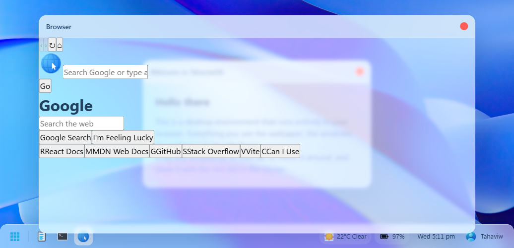

# WebOS

A desktop environment that runs entirely in your browser wallpaper, draggable
windows, taskbar and apps, all built with React.



## Try it

**[Live demo →](https://webos-tahaviw.netlify.app/)**

## Quick start

```bash
npm install
npm run dev
```

Open the URL Vite prints (usually `http://localhost:5173`) and you're in.

## Features

- Draggable windows you can stack, focus and close — grab any title bar and move it
- Taskbar with quick launch, live clock, battery and weather tray chips
- Desktop shortcuts that only ever open registered apps
- Note app with a sidebar list and a reading pane
- Browser app with multiple tabs, per-tab back/forward history, and reload
- Address bar that figures out whether you typed a URL or a search term
- Google-style home page, search results page, and embedded external sites

## Run it locally

Requirements:

- **Node.js 20.19+ or 22.12+** (Vite 8 won't start on older versions)
- No other system dependencies, no database, no environment variables

```bash
git clone https://github.com/tahaviw/Web-Os
cd Web-Os
npm install
npm run dev
```

Other scripts:

```bash
npm run build    # production build into dist/
npm run preview  # serve the production build
npm run lint     # ESLint
```

## How it works

**Window focus is a ref, not state.** `App` keeps a `z-index` counter in a
`useRef` and only writes the resulting map into state. Bumping a counter on
every mousedown is pure stacking metadata — if it lived in state, clicking
between two windows would re-render the whole desktop tree for a change
nothing can see. The counter itself never needs to render, so it never has to
be state.

**Drag listeners bind to `window`, not the header.** The obvious way to
implement dragging is `mousemove` on the title bar, but move the pointer faster
than the header and it escapes, leaving the window stuck mid-drag until you
happen to mouse-up back over it. Each drag binds `mousemove`/`mouseup` on
`window` and tears them down on mouse-up or unmount, so a drag can't leak
listeners. Windows also clamp to a minimum of 80px visible, so you can't drag
one fully off screen.

**Windows start CSS-centred.** `position` is `null` until the first drag
because the real height isn't known on the first render — a computed
`translateY` would be a guess that drifts with the content and the viewport.
The first drag reads `getBoundingClientRect()` instead of trusting stored
coordinates, so the handoff from centred to dragged is seamless.

**The browser's URL logic is one-way.** `normalizeInput()` routes whatever you
type in the omnibox: an explicit scheme passes through, anything with a dot and
a TLD gets `https://` prepaid, anything with spaces becomes a search. It's
deliberately wider than just `.com`/`www` — `react.dev/learn`, `localhost:3000`
and `.ma` domains all route as URLs, because an address bar that only
recognises one shape feels broken. History has a single write path in
`navigateTab()`, which truncates forward entries, so back/forward can't get out
of sync with the URL.

**Search results are deterministic.** The mock SERP is derived from the query
string alone, so re-rendering or navigating back doesn't shuffle results under
you. External pages load in a sandboxed iframe; reload works by bumping a key
to force a remount, since setting `src` to the same value is a no-op. Sites
that refuse to embed show a banner with an "open in a new tab" escape hatch
rather than a silent blank frame.

## Credits

- [React](https://react.dev) — the entire UI, including the window manager
- [Vite](https://vite.dev) and [@vitejs/plugin-react](https://github.com/vitejs/vite-plugin-react) dev server and build
- [ESLint](https://eslint.org) with the React hooks and refresh plugins
- Icons and wallpaper are bundled assets in `src/assets/`
